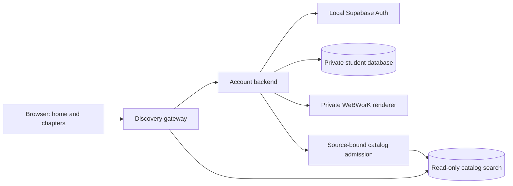

# Contributing to MathPractice

Start with [PROJECT_CONTEXT.md](PROJECT_CONTEXT.md) for current status and [AGENTS.md](AGENTS.md) for repository/data rules. Open http://localhost:3105 for the active platform. The local catalog currently contains 100 tested exercises each in calculus, algebra, trigonometry and statistics.

## Find the right application

| Area | Purpose | Start reading |
| --- | --- | --- |
| `experimental-workspace/discovery/` | Home, subject/chapter pages, search and a fixed practice gateway | [Discovery guide](experimental-workspace/discovery/README.md) |
| `experimental-workspace/accounts/` | Verified identity, ownership, encrypted sessions, attempts, drafts, sets and completion | [Current account state](experimental-workspace/accounts/CURRENT_STATE.md) |
| `experimental-workspace/practice-400/` | Shared study definitions, screened reserves and tested collection admission | [Collection guide](experimental-workspace/practice-400/README.md) |
| `experimental-workspace/workspace/` | Isolated PG integration and original six-entry prototype | [Integration contract](experimental-workspace/INTEGRATION_CONTRACT.md) |
| `experimental-workspace/opl-importer/`, `verification-pipeline/` | Read-only source indexing and bounded verification workers | Their own READMEs |
| Root `src/`, `lib/`, `supabase/` | Independent original Next.js application, port 3000 | Root README and [DATABASE_SETUP.md](DATABASE_SETUP.md) |

Keep unrelated applications out of a feature PR. Older checkpoint counts remain historical; the latest handoff and live API are authoritative. The repository is a local development platform, with separate release criteria for public deployment.

## Architecture and boundaries



The PG frame and its answer bridge are a compatibility boundary. Preserve generated names, ordered repeated fields, scripts and widget geometry. Do not expose renderer tokens, instructor responses or PG paths in student APIs. Catalog indexing alone never authorizes practice.

`practice-400/study-model.mjs` is the shared curriculum reader: it validates immutable collection/chapter identities and targets, defines display order and resolves aliases. `accounts/learning-progress.mjs` persists/provides owner-scoped completion; discovery only displays it. The [learning UX contract](experimental-workspace/LEARNING_UX.md) defines fixed denominators, explicit guest transfer and random retained sets.

`accounts/db.mjs` binds verified actor proofs to one transaction. Row-level security and owner-consistent foreign keys enforce storage isolation. `record-store.mjs` commits accepted attempts, renderer tokens and completion together. Lost/uncertain PG responses must not trigger automatic grading retries or a new seed. `set-store.mjs` freezes membership and claims a session/seed before rendering.

## Make and verify a change

1. Inspect `git status --short`; preserve work and existing volumes. Read the guide for the area you change.
2. Make one coherent change. Use explicit names, small functions and comments that explain invariants or tradeoffs. Prefer existing domain modules over a new framework or a generic abstraction.
3. Add regression checks for changed behavior or a reproduced failure. Formatting alone does not need mirrored implementation tests.
4. Run the formatting/lint check and relevant acceptance below. Never replace failed evidence or waive eligibility to get a green check.
5. Update the current handoff and describe behavior, validation and limits in the PR. Keep historical reports immutable.

Source is copied into Docker images. Rebuild after edits; Google Drive bind mounts are unreliable. Never clone OPL/renderer sources into this synced checkout. Named volumes retain OPL, student data, keys and reports; never use `down --volumes` to fix startup.

## Formatting and static checks

From the repository root, with Docker Desktop's Linux engine running:

```powershell
# Check formatting and ESLint without modifying source.
powershell.exe -NoProfile -ExecutionPolicy Bypass -File experimental-workspace/maintenance/check.ps1
# Format maintained sources, then run the same lint checks.
powershell.exe -NoProfile -ExecutionPolicy Bypass -File experimental-workspace/maintenance/check.ps1 -Write
```

The tool image uses exact lockfile versions, no host source/secret mounts and no network at execution. Write mode copies back only explicit operational source paths. Contributors with a compatible Node environment can instead run `npm ci`, `npm run check` or `npm run format` from `experimental-workspace/maintenance/`.

The initial scope covers top-level JavaScript modules and public JS/CSS/HTML in accounts, discovery and practice-400, plus the maintenance tool itself. It excludes canonical PG/runtime files, evidence, imported source/data, migrations, other pipelines and the original app. Formatting a protected runtime file changes its fingerprint and requires the separate full compatibility/republication workflow; do not add it casually to the formatter. [Prettier's installation guide](https://prettier.io/docs/install) explains why the formatter is pinned.

## Runtime acceptance

For account or learning behavior, rebuild the local account backend first; existing renderer/context/volumes must already be running:

```powershell
docker compose -f experimental-workspace/accounts/compose.yaml -f experimental-workspace/calculus-100/player.override.yaml --profile practice up --build -d --no-deps --wait backend
powershell.exe -NoProfile -ExecutionPolicy Bypass -File experimental-workspace/discovery/verify.ps1
powershell.exe -NoProfile -ExecutionPolicy Bypass -File experimental-workspace/accounts/verify-accounts.ps1
powershell.exe -NoProfile -ExecutionPolicy Bypass -File experimental-workspace/accounts/verify-learning.ps1
```

Finish rebuilds before browser acceptance. Account acceptance uses synthetic users and the dedicated local Auth project; real learning acceptance submits a student-question-derived answer to actual PG. No renderer outage check is necessary for a shell-only change. Follow the nested guide for changes to renderer/PG integration, including actual compatibility and outage checks where required.

For a clean contract-only check without local data, reproduce the GitHub workflow:

```powershell
docker build -f experimental-workspace/deployment/Check.Dockerfile -t practice-checks .
docker run --rm practice-checks
docker run --rm --workdir /service/accounts practice-checks npm test
docker run --rm --workdir /service/discovery practice-checks npm test
docker run --rm --workdir /service practice-checks node --test practice-400/contract.test.mjs practice-400/study-model.test.mjs
```

CI checks formatting, lint, contracts and existing runtime evidence. It does not deploy, activate sources or replace real Auth/renderer/browser acceptance, physical-device checks or screen-reader listening.

## Privacy and reporting

Do not commit credentials, cookies, tokens, raw student attempts/drafts, instructor answer maps, database dumps or screenshots of private answers. Test reports should contain sanitized flags, counts and hashes. Report security issues privately to the repository maintainers; do not include private student data in public issues. Exercise defects can be submitted through the app's Report a problem action, whose records remain encrypted and owner-bound.
