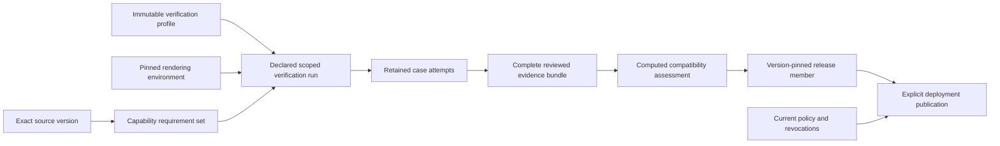

# Compatibility evidence and activation model (task 5.5)

Defined 2026-11-15 following metadata commit `9665c50`. Extends [exercise identity](EXERCISE_IDENTITY.md), [taxonomy](TOPIC_TAXONOMY.md) and [metadata](CATALOG_METADATA.md) into a full-library persistence model. The existing [catalog compatibility contract](CATALOG_COMPATIBILITY.md) and [assessCatalogEntry](workspace/server/catalog-compatibility.mjs) remain the runtime authority. This task does not replace that gate, publish a batch, migrate a database or run new PG/browser verification.

## Decisions

1. Persist **requirements**, **verification evidence**, **compatibility assessment**, and **activation** separately. An indexed exercise or verified capability is not permission to practice it.
2. Evidence binds to an exact exercise source version, complete capability requirements, immutable verification profile and rendering/deployment environment. Titles, source aliases, topic assignments and byte-identical copies cannot transfer approval.
3. Preserve run targets, every observed case/attempt and failure history. Completeness means all declared required work is accounted for, not that every case passed. Known unsupported capabilities never excuse a required grading/ownership/keyboard failure.
4. Compatibility is computed from evidence; stored claims and client flags cannot confer approval. The current status precedence and failure details are retained, including unsupported GraphTool with its failed mobile grading cases.
5. Activation is an explicit, version-pinned publication decision for a deployment scope, with withdrawal/rollback history. Withdrawal preserves source, evidence and student records. Restoring old flags cannot bypass stale proof or a current revocation.
6. Normalize legacy snapshots honestly: missing worker identities, attempt history, source-version UUIDs, PG/dependency fingerprints and approval actors remain unknown. Do not manufacture them from a current README, Git author, batch name or successful rerun.

## Proposed logical entities

Final SQL naming, indexes, grants, row-level security, transaction boundaries and queues are later tasks 5.6–5.8. UUIDs in the example projection are null because no database allocation occurs.

| Entity | Identity and minimum fields | Constraints / relationships |
| --- | --- | --- |
| Capability definition/version | Capability key, version, description, detection/review method | Unknown macros/widgets/scripts produce unknown requirements, never support by default. Detecting a capability does not verify an exercise. |
| Exercise requirement set | Source-version ID, version/digest, required capability versions, discovery completeness/provenance | Complete explicit requirements are needed for approval. A changed source/requirement set invalidates prior applicability. An empty or uncertain set is not a shortcut to native-text support. |
| Rendering environment | Environment UUID/digest, renderer and PG revisions, deployed source snapshot, dependency/asset closure, build/configuration identity | Trusted operator/deployment provenance; no private keys or renderer tokens in evidence. A Git label alone does not prove installed bytes. Unknown legacy identity cannot be labeled full environment certification. |
| Verification profile/version | Immutable ID/digest, scope, required capabilities/support states, seed strategy, viewports and required check definitions | Preserve current local profile as-is. Altering checks, supported capability states or environment policy is a new profile/review, not editing evidence to pass. |
| Verification run | Run UUID, immutable target manifest/digest, source/environment/profile/runner identity, timestamps, orchestration state, provenance | Declare target subset before execution. A small complete batch can be valid; an arbitrary focused/partial report is not a complete larger run. Scope changes require a new manifest/run. |
| Run target / case definition | Run + source-version + required seed + viewport + check-set identity | Exactly one selected authoritative result per required combination in an assessment bundle. Retain missing/error/duplicate diagnostics. Public verification seeds remain distinct from private student-session seeds. |
| Case attempt | Case/attempt UUID, outcome, source identity check, check booleans, grading scores, failure/limitation codes, runner provenance and time | Append-only retries; no overwrite of failed attempts. Keep private instructor/calibration data, entered pairs, cookies, tokens and raw HTML outside stored/committed observations. |
| Evidence selection / bundle | Exact target set, selected run/case attempts, profile/environment/requirements identity, review/supersession rationale | A selected complete bundle supports an assessment. Never stitch unrelated runs/versions or cherry-pick a passing duplicate to erase a failed required case. Explicit authorized supersession retains old evidence. |
| Compatibility assessment | Assessment UUID, source/requirements/profile/environment/bundle IDs, computed status/issues, evaluator version/time | Reproducible, immutable decision. Unsupported and failed are not interchangeable history buckets; all underlying reasons remain queryable. |
| Activation release / batch | Immutable manifest, deployment scope, profile/environment, approval principal/time, release state | A future member pins stable exercise UUID, source-version UUID and accepted assessment; a legacy exercise alias alone is insufficient. Membership is not auto-publication. |
| Activation member / event | Exact member tuple, enabled/withdrawn event, actor/reason/time, prior release/event references | Append-only approval/withdrawal/rollback trail. Current publication pointer changes atomically; historical releases/results remain intact. Global and member-specific revocations must have explicit precedence. |
| Deployment policy decision / incident | Scope, operational/rights/access policy references, source presence, revocation/incident state | Separate from technical compatibility. Metadata publication, license evidence and account entitlement are not inferred from a renderer score. Transient infrastructure outages are not mathematical wrong answers. |



## Compatibility states and their meaning

Reuse the existing vocabulary and computation. These are not a single mutable workflow enum that loses history.

| State | Meaning | Eligible for activation? |
| --- | --- | --- |
| unverified | Missing/incomplete proof or requirements; a new import defaults here | No |
| stale | Source/path, requirements, runtime, profile, renderer/library or environment differs from the evidence identity | No; produce matching new evidence |
| unsupported | A required capability or observed behavior is unsupported under the profile | No; retain other failures too |
| failed | Required regression assertions fail | No |
| limited | Required checks pass but an observed limitation remains | No under the current profile |
| verified | Every required case/check passes, no remaining limitation, identity matches | Only with explicit current publication and applicable deployment policy |

Current evaluator precedence: missing proof/incomplete coverage can return unverified; identity mismatch returns stale; once applicable complete evidence is available, unsupported takes precedence over failed, then limited, then verified. Preserve all issue codes. A GraphTool status of unsupported does not erase its two REGRESSION_FAILURE issues. A stored status that disagrees with the computed result blocks enablement.

Capability support has its own per-profile state. A globally verified `native-text`, `matrix-grid` or asset capability is necessary where required but never sufficient for a new file. Conversely, a particular matrix exercise's narrow-layout limitation is evidence about that exercise, not permission to downgrade or waive the mobile check globally.

Run orchestration states (queued/running/completed/incomplete/cancelled) and attempt outcomes (passed/failed/error/blocked) are independent of these compatibility states. Completed execution may include failed tests. Infrastructure errors stay explicit and cannot be recoded as correct, incorrect or permanently unsupported content without evidence.

## Coverage, provenance and failure retention

The current local profile requires seeds **1234/4321**, **desktop/mobile**, and nine checks: rendering, interaction, answer capture, grading, retries, refresh, ownership, keyboard and mobile layout. Each target needs all four seed/viewport combinations exactly once in its selected bundle, actual source verification, completion, all checks true, correctScore 1 and clearedScore 0. No known limitation may remain before that file becomes verified. Preserve this baseline; random variants beyond these seeds are not certified by it.

For the full-library queue, declare a bounded target manifest for each batch. Complete means every manifest target and required combination is accounted for. Missing workers, timeouts, unreadable sources, duplicate keys, omitted exercises and partial reports remain incomplete/error outcomes. Do not redefine the target manifest after seeing failures. The existing publisher still requires a complete matching eleven-fixture report; this design is not an implemented replacement or a way to publish its focused runs.

A retry appends an attempt. Selecting a later pass requires an explicit evidence bundle/supersession reason under the same applicable identities and the full required coverage. Historical failures remain visible and retrievable. Unsupported behavior or a changed environment usually requires remediation and new applicable verification, not a retry-until-green policy. Do not silently select the latest successful attempt or discard source-hash failures as flaky.

Different files may progress independently: a structurally complete run can retain failures for some targets while verified members advance in an explicit batch. Full gate exit status remains failed when required cases fail. The current 42/44 outcome is preserved; enabling unrelated passing entries does not turn that run into a green result.

Evidence must be produced by trusted isolated operator workers and validated by the publisher against the target/source/profile/environment manifest. Store bounded, structured sanitized results, not arbitrary public client reports, raw exception bodies or privileged response payloads. Importer macro guesses and browser-supplied capability metadata are not worker proof. Authenticated worker provenance/signing, resource limits, durable queue leases and deployment hardening still require implementation later; the legacy evidence snapshot does not already supply them.

## Enablement and publication contract

For the current local runtime, keep the existing conjunction:

- exact indexed source identity, renderer path and explicit capabilities match evidence;
- evidence matches current runtime fingerprint, renderer/library revision and profile;
- complete unique seed/viewport coverage, required scores/checks and source verification;
- all required capabilities supported and no failed checks/limitations;
- stored compatibility claim matches computed verified assessment;
- entry explicitly enabled and included in an active batch for the matching profile.

The future persisted model pins these facts to source-version/environment/assessment IDs and an atomic publication manifest. Add deployment-specific policy/access/rights/source-presence/revocation checks as separately explicit gates when implementing that deployment. Do not silently change today's local policy or treat legacy records with unknown environment details as satisfying a stronger public-deployment profile.

Publication workflow:

1. Stage imported identities/metadata disabled; infer candidate requirements conservatively.
2. Execute declared verification runs and retain all attempts/diagnostics.
3. Validate a complete applicable evidence bundle and compute assessment.
4. Prepare an exact release manifest of verified source versions and assessments; fail the proposed publication if any requested member is ineligible. Unrequested failures remain recorded and disabled.
5. Approve and atomically publish the manifest for the intended deployment scope. Record reviewer/service identity, reason and prior publication version; compare the expected publication generation to avoid concurrent lost updates.
6. Recheck eligibility on list/start/restore/grade through one authority; discovery caches are not authorization. Withdraw a member or whole batch explicitly, retaining every record. Re-enablement is a new deliberate event using still-applicable proof, not a side effect of reimporting metadata.

Publication states are draft/proposed, approved, published and withdrawn/retired with append-only transitions, not an importer-controlled boolean. The existing JSON active/inactive batch is a current-state snapshot, not this historical ledger. Preserve its semantics while migrating rather than inventing old actors or activation timestamps.

The existing gate rejects disabled IDs for starts, restoration and grading. Keep that behavior through migration until a separately designed policy explicitly changes it. Saved records, drafts and tokens remain intact; the UI gives an unavailable/recovery state rather than another exercise. A rollback may select a retained release only if its exact source/environment remains deployable and eligible and current revocations/policy permit it. An obsolete approval or alias cannot resurrect a withdrawn source implicitly.

Dynamic database publication also needs an in-flight grading protocol: use a publication generation/transaction check, retain accepted or uncertain renderer state atomically and never automatically resubmit because withdrawal raced a response. A renderer result already produced cannot be treated as if nothing happened. Block new work according to the current policy, preserve private history/token continuity, and reconcile explicitly. This protocol and its ownership/concurrency constraints are future tasks 5.6/5.7, not functionality already implemented by the local immutable JSON snapshot.

## Freshness, invalidation and retained history

| Change | Required model behavior |
| --- | --- |
| PG source revision/path/hash or capability requirements change | New source/requirement identity and applicable evidence; retain old version, assessment and results. No copy/hash/rename-based approval inheritance. |
| Renderer, PG, asset/dependency closure, runtime or profile changes | Mark prior decisions inapplicable for the new target context; require new evidence under that context. Never edit fingerprints manually. |
| Friendly title, taxonomy or metadata review changes | No compatibility transfer or reset solely from labels; source/evaluator identity still controls. Publish metadata/taxonomy separately. |
| Batch/member withdrawn | Stop applicable operations through the common gate; retain source, evidence, sessions and all attempts. |
| Transient renderer/worker outage | Record infrastructure failure and useful recovery; do not silently reroll or declare a mathematical error. A failed check is not a pass. |
| Source missing from an incomplete import | Do not infer deletion; follow the complete scoped-presence rules from task 5.2. |
| Reimport sees a previously disabled/withdrawn exercise | Preserve identity/evidence; import alone cannot re-enable it. |

Database retention should restrict destructive cascades from source, profile, taxonomy or activation changes into student history/evidence. Revocation changes current permissions, not historical facts. Any later retention/privacy deletion policy is explicit and separate from catalog cleanup.

## Mapping existing artifacts to the proposed model

| Current artifact | Reusable data | Missing detail that must remain unknown |
| --- | --- | --- |
| exercise-catalog.json | Legacy identity, source tuple, renderer path, requirement list, compatibility claim, entry activation | No allocated source-version UUID or historical requirement decisions |
| compatibility-profile.json | Scope, profile key, pinned revisions, capability statuses, seeds/viewports/checks | New persisted immutable ID/semantic digest and stronger environment/worker policy |
| catalog-compatibility-evidence.json | Observed envelope, source/runtime/profile identity, per-entry selected cases/checks/scores/issues | Worker provenance, every retry/attempt, reviewer, direct PG/dependency digest; no proof these can be reconstructed |
| activation-batches.json | Current active/inactive batch, profile key, member aliases | No historical event ledger, approval actor/time or per-member source-version/environment pins |
| Existing evaluator and publisher | Fail-closed computed eligibility and complete-report/source/manifest validation | Full-library staging/queue, database constraints, transactions and scalable release implementation |

[compatibility-model-examples.json](catalog-model/compatibility-model-examples.json) is an executable design projection of these current artifacts. It preserves all 11 entries and 44 selected case observations, normalizes capability/profile/requirement/run/batch/decision data and leaves unsupported historical details null or not-recorded. Separate evidenceBindings retain the source, renderer path and requirements actually tested, independently of current catalog declarations. Case binding keys are scoped example references, not allocated UUIDs; the legacy envelope does not explicitly record repository identity, so that field remains null as well. Digests are recursively key-sorted JSON digests, with array order retained; they are not raw-file hashes, signatures or new verification evidence. The model never overwrites workspace/server/catalog-compatibility-evidence.json.

Current technical decisions remain **7 verified, 2 limited, 2 unsupported; 6 enabled**. Economics is verified but outside the batch. GraphTool retains both mobile grading failures even though its primary compatibility state is unsupported. The old complete run is still **42 required passes / 2 required failures**; this task has not rerun it.

## Student and operator views

Public discovery can show safe metadata with a coarse unavailable/pending label in an explicitly selected indexed view. Do not expose source paths, verification seeds, raw failures, instructor maps or worker tokens. Practice actions and counts use the live gate, not a preview snapshot or stored verified flag. Unavailable content remains distinct from a student's incorrect answer.

An operator view should expose target scope, pending coverage, identity/environment mismatch, retained failures, retry/supersession reasons, capabilities, chosen evidence bundle and publication/withdrawal history. It must clearly distinguish indexed, technically verified and currently enabled counts. No operator dashboard or new public route is implemented in task 5.5.

## Verification and next work

From the repository root, with the existing workspace running:

```powershell
powershell.exe -NoProfile -ExecutionPolicy Bypass -File ./experimental-workspace/catalog-model/verify-compatibility-model.ps1
```

The [normalizer](catalog-model/compatibility-model.mjs) invokes the actual catalog assessor rather than reimplementing eligibility. The [runner/checks](catalog-model/verify-compatibility-model.ps1) read current copied server JSON and compare model decisions to inspectCatalogCompatibility. It writes only sanitized design artifacts to temporary container storage and copies them back. No PG requests, private session reads, service interruption, database writes or activation changes.

Fresh [model observations](catalog-model/compatibility-model-observations.json): **15 contract checks pass**. They verify preservation of all live decisions, complete-versus-passing distinction, both GraphTool failures, unbatched verified content, hypothetical withdrawal, missing batch, stale runtime/source, incomplete/duplicate coverage, failed ownership, absent per-file proof, changed requirements, retained retry failures, unknown history and no input mutation. Hypothetical edits exist only in cloned memory; the actual catalog remains unchanged.

These checks do not implement SQL, a queue, atomic database release, historical worker authentication or the future in-flight grading protocol. Existing 173-server/62-browser and 42/44 seeded results remain historical implementation evidence. Public deployment still needs the manual/device, ownership/persistence and hardening work already recorded.

Next: **5.6 — student-record relationships and privacy boundaries**, followed by **5.7 — constraints/query patterns** and **5.8 — additive migrations and model validation** before connecting the full-library importer and discovery UI.
