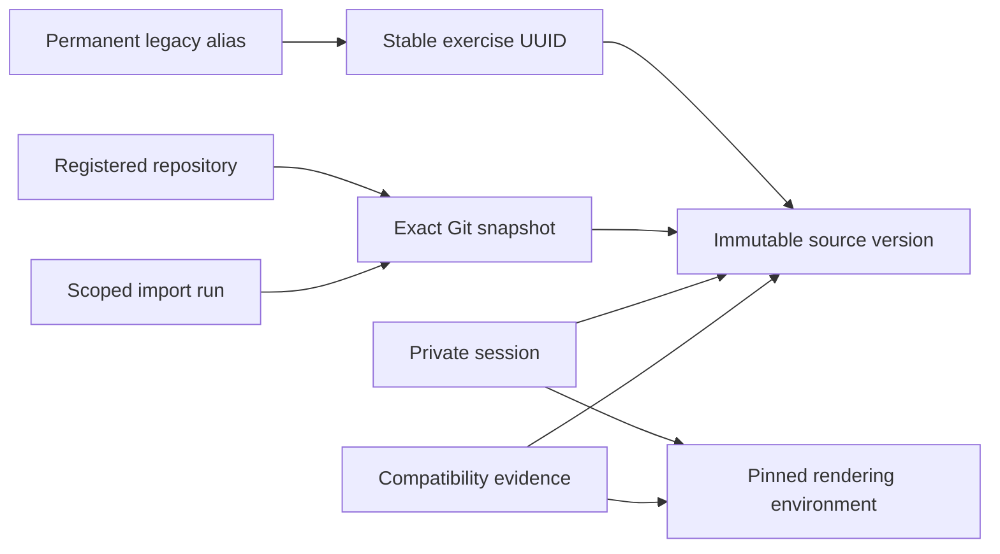

# Exercise identity and immutable source versions (task 5.2)

Design decision, 2026-11-15. Based on [the model/OPL audit](CATALOG_MODEL_AUDIT.md), following audit commit `d042eed`. This defines the contract for later schema/importer work; no database migration, runtime resolver or library activation is implemented here. Task 5.8 will implement the schema after the remaining model decisions.

## Decisions

1. Each catalog exercise gets an opaque, persisted UUID v4. It is independent of source path, title, topic, file hash, repository commit and import order. Allocate once in a committed import transaction; retries retrieve that identity from the registry rather than generate a replacement.
2. Every existing experimental string ID remains a permanent namespaced alias. The [bootstrap plan](catalog-model/identity-bootstrap-plan.json) inventories all eleven aliases and their present source tuples. It deliberately leaves internal UUIDs null until migration. Preserve existing authored Supabase UUIDs in their original provider/model; never join a PG record to authored content by title, path or coincident identifier text.
3. An immutable source version binds one exercise to a registered repository, exact Git snapshot, canonical repository-relative PG path and SHA-256 of original file bytes. Every new snapshot creates a new version observation even if the PG bytes are unchanged, because macros/assets elsewhere may have changed. Byte blobs may be deduplicated as storage, never as exercise identities.
4. Rename evidence creates a proposal, not an automatic identity merge. Copies at another path retain distinct identities. Accepted rename decisions preserve the original exercise UUID and append provenance; old versions and aliases remain intact.
5. Missing upstream files are recorded as absent after a complete import of their scope. Withdrawal does not delete exercises, versions, evidence, aliases, attempts or sessions. Source presence, compatibility, activation and editorial publication are separate facts.
6. Student sessions created after integration bind to an exact source version and rendering environment at start. Legacy records with no such binding stay explicitly legacy/unknown; the present catalog is not evidence of their historical source. No silent reroll or source substitution repairs them.

## Conceptual entities and keys

Names describe the proposed logical model; final SQL names, indexes and RLS follow in tasks 5.6–5.8.

| Entity | Identity and minimum fields | Constraints / purpose |
| --- | --- | --- |
| Catalog exercise | exercise UUID, provider, createdAt | UUID is permanent; no source metadata in the primary key. Lifecycle does not encode correctness or playability. |
| Exercise alias | namespace, externalId, exercise UUID | Unique namespace/externalId, immutable target, never recycled. Initial namespace `experimental-opl`; old authored UUIDs remain in their own provider. Existing HTTP IDs continue to resolve through aliases when integrated. |
| Source repository | repository UUID, registry key, canonical upstream URL | Unique operator-controlled key (`openwebwork-opl`). Repository identity survives URL changes recorded by a reviewed registry update; arbitrary URL normalization must not merge forks or unrelated providers. |
| Source snapshot | snapshot UUID, repository UUID, commit object format/OID, tree OID, provenance | Unique repository/object-format/commit-OID. Full SHA-1 (40 hex) or SHA-256 (64 hex) Git IDs are algorithm-labelled; file SHA-256 is a different field. An import branch name is not a version. |
| Import run and covered scope | run UUID, snapshot UUID, scopes, manifest digest, scanner version, started/completed state, diagnostics | Repeated runs may observe one snapshot. A failed/partial run is retained but cannot infer removal, activate entries or rewrite an immutable version. Scope is explicit: OpenProblemLibrary, Contrib or Pending. |
| Source version | version UUID, exercise UUID, snapshot UUID, canonical path, source SHA-256, observation provenance | Unique snapshot/path and exercise/snapshot for accepted authoritative versions. Repository is derived from snapshot. Upsert with a different owner/hash for the same key is a conflict, not an overwrite. Unassigned candidates stay in staging. |
| Source-location registry | repository UUID, canonical path, assigned exercise UUID, presence and assignment-event references | Current lookup for repeat imports; update transactionally. Keep the assignment/presence history. A historical path is not a public exercise alias and must not be silently rebound after disappearance. |
| Identity decision/event | event UUID, proposal/run, old/new source locations, decision, evidence, reviewer/service principal, time | Append-only provenance for reviewed renames, replacements, reappearances or rejected matches. Git similarity, same bytes, MLT and titles are evidence, not authority to merge. |
| Rendering environment and private resolver | environment identity, renderer/PG revisions, dependency/asset manifest, deployed snapshot, approved repository-to-renderer mapping | Source version alone is not a reproducible execution environment. Resolver paths are backend configuration, not client input or exercise identity. Dependency completeness remains an explicit requirement for later verification/deployment work. |

A content hash is a property of bytes. A version identifies their repository/snapshot/path context. An exercise identifies the continuing practice item. An alias keeps old references working. None substitutes for the others.

## Canonical paths and trusted snapshot ingestion

- Store repository-relative POSIX paths exactly, including case and Unicode spelling. Source is Linux-hosted; case-folding can collapse distinct files. Do not normalize Unicode silently.
- Reject absolute/drive paths, backslashes, NUL/control characters, empty components, `.` / `..`, repeated slashes and non-PG candidates before registry resolution. Do not percent-decode a repository filename. Paths never come from a student request.
- Scope is the exact leading path component. Preserve `OpenProblemLibrary`, `Contrib` and `Pending` separately. Moving between scopes is a rename proposal and does not grant compatibility, licensing or editorial approval.
- The importer must enumerate the pinned Git tree/manifest and verify raw-byte hashes, rather than trust a working-tree HEAD label. Untracked files are not source versions of that commit. Treat symlinks as unsupported/quarantined until an explicit contained-resolution policy exists; do not follow paths outside the registered tree.
- Only a complete, validated run for the same repository and relevant scopes can mark a previously present location absent. Excluded scopes, parser failure, interrupted traversal and unreadable files cannot establish deletion.
- Current `OpenProblemLibrary/...` → renderer `Library/...` mapping is an explicit existing mapping, not a generic rule for Contrib, Pending or every dependency. Store resolver mappings separately and verify required assets/macros under the pinned environment.

## Import/update decision table

| Observation | Identity decision | Version / eligibility consequence |
| --- | --- | --- |
| Repeat the same complete snapshot/path/hash | Reuse registry identity and existing version | Idempotent observation; add run provenance without duplicating rows or attempts. |
| Same snapshot/path, different bytes or proposed owner | Reject/quarantine that candidate; record integrity/identity conflict | Never mutate the stored version or relabel altered bytes with an old commit. |
| New snapshot, known continuously present path, same hash | Keep exercise UUID; create a new snapshot-bound version | Do not inherit approval: dependencies or environment may differ. |
| New snapshot, known continuously present path, changed hash | Keep exercise UUID as normal upstream revision; create a new version | Prior versions/results remain; new version starts unverified. Semantic replacement cannot always be inferred statically and may require an explicit replacement decision. |
| New path; former path is still present | New exercise identity for the copy, even with identical hash | Record duplicate candidate/group if useful; no automatic merge of attribution, history or evidence. |
| Old path absent; new path looks like a rename | Stage an unresolved proposal with hash/Git/provenance evidence | Existing identity remains reserved; do not activate or create aliases for unresolved correspondence. Rejected proposals can become distinct new exercises. |
| Rename accepted after review | Reuse old UUID; append location decision; new snapshot/version at new path | Retain old alias/version; verify new resolver/dependencies and compatibility. |
| Multiple old/new matches or duplicate identical files | Keep ambiguous occurrences staged until resolved; do not pick by traversal order | No bulk hash-based redirect, merge or approval. Independent new files may later receive independent identities. |
| Known path absent in complete scoped import | Mark location absent and record removal; retain identity | New starts unavailable unless a deliberately retained, approved deployment still serves the pinned version. No record deletion or fallback to another exercise. |
| Partial/failed run does not see an old path | No absence decision | Preserve prior presence/evidence; report incomplete import. |
| Absent path reappears | Stage reappearance review even if hash matches | Explicitly restore prior identity or assign a genuinely different item through an append-only replacement decision. Never silently recycle historical identity/aliases. |
| Path is explicitly replaced by a different exercise | Allocate a new exercise UUID only after review; record new assignment epoch | Old aliases still target the original UUID; old versions/history remain. Registry update must not make old session references resolve to the new item. |
| Import revisits an older snapshot | Record historical observation; do not move the current deployment/location head backwards | History import is not a rollback or reactivation command. Snapshot ordering is not lexicographic Git SHA ordering. |
| Same title, same MLT or mathematically similar statement | No identity equivalence established | Search/grouping clues only; do not merge or label licensing/compatibility as inherited. |
| Same bytes in another repository/fork | Separate repository occurrence and exercise identity by default | Cross-repository lineage needs a deliberate relationship, not hash deduplication of student history. |

Accepted source versions have one authoritative path per exercise per snapshot. Multiple simultaneous paths are distinct exercises by default, not extra active locations of one version. If a future curated duplicate relationship is desired, model it separately; do not collapse primary identities or rewrite historical attempts.

## What changes, what stays immutable

- Source versions, aliases, accepted results, verification runs and identity decisions are append-only records. Corrections append superseding decisions; they do not edit historical provenance.
- Friendly titles, descriptions and topic assignments may change without replacing an exercise identity. Their provenance/versioning is task 5.3/5.4; they never alter a source hash or evaluator.
- A later source version can be the latest observed candidate while an older version remains the deliberately deployed/approved one. Keep latest-observed, deployed and approved references separate. The existing runtime supports one deployed library revision; this design does not claim concurrent historical rendering already works.
- Compatibility is bound to the exact source version, environment, runtime/profile and required seed/viewport evidence. A new version, rename or dependency change must not inherit approval from an alias, byte hash, related exercise or previous activation batch. Explicit publication chooses what is playable.
- Rollback selects a retained source/environment with matching evidence. If it is no longer deployable or permitted, show explicit unavailability; never reconstruct another random exercise as a substitute.

## Session and historical-data binding

New integrated sessions need stable exercise UUID, source-version UUID, rendering-environment identity, original seed, ownership and renderer state together. Grading attempts refer to that session/version; bookmarks and topic assignments usually refer to the stable exercise. A practice set must define whether it pins versions when built or when sessions start; choose that later without changing already started sessions.

Current private session JSON has only an exercise string ID and tokens/seed, not a proven source version or environment. During later migration preserve that ID through an alias and mark provenance `legacy-unbound` unless trustworthy creation-time evidence establishes an exact binding. A lookup of today's matching file is not proof. Preserve existing token-based continuation where supported by the current deployment; fail explicitly when unavailable. Never invent old seeds, historical attempts, source bindings, account owners or PG verification.

Existing root Supabase exercises/attempts remain authored/legacy provider data. Keep their UUIDs and original grading provenance. Allocating PG catalog UUIDs does not migrate those rows or make client-calculated is_correct authoritative PG evidence.

## Bootstrap the current eleven IDs later

[identity-bootstrap-plan.json](catalog-model/identity-bootstrap-plan.json) is a design inventory, not a new allowlist. Every current ID, including all five disabled entries, is represented with its existing repository-relative source identity and renderer path. All proposed internal IDs remain null.

For the later migration:

1. Create/resolve the registered repository and validated snapshot using trusted installed sources. Treat present catalog metadata as candidate input, not proof of every historical session.
2. In one transaction or resumable uniquely keyed stages, allocate/retrieve one catalog UUID per namespaced legacy ID. Persist aliases permanently; concurrent runs must resolve uniqueness conflicts to the existing identity, not mint alternate rows.
3. Validate and insert immutable source-version tuples; reject duplicate aliases/paths or hash disagreements. Do not fabricate a dependency closure or mark it verified merely because the source file matches.
4. Keep compatibility data and explicit activation separate. Changing identifiers must preserve eligibility decisions and blocked cases, not recertify them. Update runtime resolvers/API consumers only in the later integration with regression evidence.
5. Preserve original session strings and keep legacy-unbound provenance. Populate an internal identity reference through its alias without claiming source-version or account ownership that is not established.

No real UUIDs are allocated, no legacy row/session is edited and no catalog/publisher is replaced in task 5.2.

## Acceptance examples for schema/importer work

| Case | Required result |
| --- | --- |
| Dot-product legacy alias resolves after migration | Same friendly exercise, stable internal UUID, permanent `experimental-opl:dot-product-01` alias; ordinary requests still use server-owned source resolution. |
| Two parallel bootstrap transactions process that alias | Exactly one committed UUID/alias pair; loser resolves the existing row. No history or activation duplication. |
| Same snapshot imported twice | Same exercise/version IDs; distinct run records allowed; no destructive rewrite or new activation. |
| Two different files have identical bytes | Distinct identities/attribution; optional duplicate relationship; a correct result on one is not an attempt on the other. |
| A file moves and is later edited | Reviewed rename preserves exercise UUID; subsequent snapshot creates another source version; all versions/results remain queryable. |
| Source changes from bytes A to B then back to A | Three snapshot-bound versions, one continuously identified exercise; the later A does not reuse the old source-version ID or approval. |
| Only an image/macro changes in a new commit | New snapshot-bound source version even when PG hash is unchanged; reverify under the changed environment. |
| Source disappears during an interrupted import | No withdrawal inferred until a complete relevant-scope observation establishes absence. |
| A different item later occupies the old path | Review and new identity/assignment event; old alias/bookmark/session history still identifies the original item. |
| Topic/title changes or exercise is assigned to two topics | Exercise UUID and source identity unchanged; taxonomy work records mappings separately. |
| Historical session has no source pin | Keep legacy-unbound provenance and original state; do not attach the newest source version by inference. |
| A withdrawn or unsupported entry is imported again | Indexing preserves identity but cannot reactivate or bypass compatibility rules. |

The [bootstrap verification command](catalog-model/README.md) checks alias coverage/uniqueness, exact correspondence to all eleven current catalog entries and installed source-byte hashes. It does not implement or test future transactional rename/withdrawal algorithms: the cases above are acceptance requirements for tasks 5.7/5.8 and the importer. No database constraint or production behavior is claimed implemented by this document.

Task 5.3 is now specified in [TOPIC_TAXONOMY.md](TOPIC_TAXONOMY.md): raw OPL classifications and curated Subject → Chapter → Section taxonomy build on these identities without encoding topics into keys. Next is student-facing metadata (5.4).
