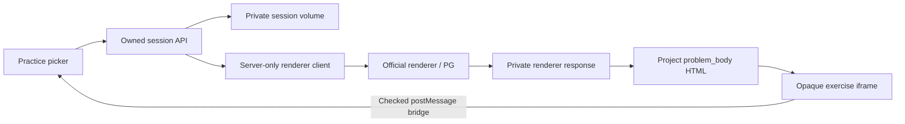

# Renderer integration contract

Scope: the experimental workspace as implemented on 2026-11-14, including the [controlled asset loader](ASSET_LOADING.md). This describes current behavior, including limitations. It does not promise compatibility for every PG problem. The student allowlist remains [exercise-catalog.json](workspace/server/exercise-catalog.json); the separate [compatibility catalog](compatibility/catalog.json) is operator-only.

## Data and trust boundaries



Only stable exercise IDs and answer pairs cross the student API boundary. Source paths, seeds, renderer settings, ownership hashes, and renderer JWTs remain server-side. The renderer's localhost editor/raw API is an operator tool and is not the student interface.

## 1. Renderer client and session service

Implementation: [renderer-client.mjs](workspace/server/renderer-client.mjs), [exercise-sessions.mjs](workspace/server/exercise-sessions.mjs), and [grading-feedback.mjs](workspace/server/grading-feedback.mjs).

- `loadExercise({exerciseId, seed})` resolves an approved catalog ID and posts URL-encoded form data to the configured `/render-api`. The client fixes JSON/default output, student mode, hidden solutions, and hidden correct-answer controls.
- `restoreSession` uses the stored session token. It never silently falls back to a newly generated problem.
- `submitAnswers` sends ordered name/value pairs using the stored token. Browser-provided paths, seeds, tokens, privileged flags, and scores are not accepted by the HTTP API.
- Requests have a default 30-second deadline covering headers/body, reject redirects, validate JSON and PG errors, require usable HTML/tokens/resources, and require a numeric overall score in `[0,1]`. There are no automatic grading retries.
- Student responses containing a top-level instructor `answers` map are rejected. Debug/cause information stays out of public errors.
- The normalized private result retains full `renderedHTML`, resource metadata, session/problem tokens, score, and plain-text overall feedback. During grading, the private `JWT.answer` payload at `score.answers` supplies an allowlisted per-field projection; correct answers and other claims are discarded from that projection.
- PG `error_message` may contain mathematical hints. For the verified MathObjects flow, explicit PG error flags or an error with an explicitly absent parsed `student_value` identify invalid input. Parsed coordinate hints remain mathematical errors. Other evaluators need separate verification.
- Ownership is checked before PG calls. The file service atomically saves updated tokens with the latest accepted submission. It retains one snapshot, not full history. The overlap guard supports one Node process.

Public session responses contain friendly session metadata, projected exercise HTML/score, opaque approved dependency URLs, and an optional saved submission with exact pairs and safe feedback. They expose no seed, JWT, source path, owner hash, debug payload, or resource alias/regex mapping.

## 2. HTML projection

Implementation: `problemHtml` in [http-app.mjs](workspace/server/http-app.mjs). It is a named Node export for operator QA reuse; that does not add an HTTP route.

The server parses the full renderer document with parse5, requires exactly one element whose ID is `problem_body`, and serializes that element including its wrapper. This is a DOM projection, not a byte-preserving copy and not a general sanitizer.

| Content | Current handling |
| --- | --- |
| Question text, element hierarchy, IDs/classes, tables, labels, native answer controls | Preserved within the selected wrapper, subject to HTML parser normalization. |
| Inline SVG, images, links, data attributes | Preserved as HTML; URL loading/navigation is separately constrained by the iframe. |
| Inline styles, style elements, inline scripts, event attributes inside the wrapper | Preserved. Inline executable content can run in the frame; it may fail when required header dependencies are missing. |
| `sessionJWT`, `problemJWT`, `answerJWT`, `sourceFilePath`, `problemSeed` named controls inside the wrapper | Removed recursively. Other reserved/helper names can remain in HTML but are excluded by answer collection. |
| Renderer outer form, submit/preview/correct-answer buttons, hidden management fields outside the wrapper | Excluded with the surrounding document. |
| Renderer head, header/post-header scripts/styles, asset tags, base element, footer/debug panels, overall result outside the wrapper | Excluded. A separate asset preparation step extracts reviewed external script/stylesheet tags in order, preserving defer; unreviewed header content remains excluded. |
| Image/script/style/link URLs | Unchanged by `problemHtml` alone; the following resource stage rewrites approved images, body script URLs, and dependencies to opaque capabilities. |

The grading API returns a newly rendered problem fragment, but the picker currently keeps its existing frame and applies only the saved result/feedback. This preserves live edits; it does not apply newly revealed fields, stage-specific content, or new dependency initialization. The positive scaffold transition in [COMPATIBILITY_MATRIX.md](COMPATIBILITY_MATRIX.md) demonstrates that limitation.

The frame subsequently removes `.ww-feedback-btn` controls and PG correctness classes from native inputs. The application supplies its own plain-text field feedback and overall result.

## 3. Resource loading and iframe execution

Implementation: [exercise-frame.js](workspace/public/exercise-frame.js), the MathJax proxy in [http-app.mjs](workspace/server/http-app.mjs), and frame creation in [picker.js](workspace/public/picker.js).

The parent builds an `iframe.srcdoc` document with `sandbox="allow-scripts"`. It grants no same-origin, form, popup, download, or top-navigation permissions. The parent has no frame DOM access. Self-frame link/navigation behavior is not comprehensively disabled; do not interpret the sandbox as an all-navigation blocker.

The frame policy is:

```text
default-src 'none';
script-src 'unsafe-inline' <configured parent origin>;
style-src 'unsafe-inline' <configured parent origin>;
img-src data: <configured parent origin>;
connect-src 'none';
form-action 'none';
base-uri 'none';
```

| Resource/behavior | Current support |
| --- | --- |
| Self-hosted MathJax JavaScript | Explicit `/assets/mathjax/` proxy accepts safe `.js` paths under the configured renderer's MathJax directory. It rejects redirects, has a 15-second timeout, and caches successful responses for one hour. |
| Legacy PG `script[type^="math/tex"]` | Converted to text delimiters before MathJax typesetting; SVG math and assistive MathML are retained. Overflowing expressions receive keyboard scrolling targets. |
| Renderer `resources.assets` strings | Kept private. Public resources contain an empty legacy assets list and ordered reviewed dependency records. |
| Renderer resource aliases/regex maps | Exact image aliases are resolved on the server. Regex maps remain unused; neither mapping is exposed. |
| Reviewed PG header JavaScript/CSS | Ordered jQuery, Bootstrap, GraphTool, Scaffold/details dependencies and pinned JSXGraph are supported through opaque URLs. Original body initializers remain inside the frame. Upstream editor/submit helpers and MathQuill initialization are excluded. |
| Library/generated image URLs | Approved `/pg_files/tmp/images/` references and exact aliases are rewritten to expiring opaque resources. Reviewed GraphTool stylesheet icons use the same resolver. No arbitrary renderer image endpoint is exposed. |
| Data images and inline SVG | Permitted by the relevant current policy/HTML handling; each exercise still needs observation. |
| Other external dependencies, fonts, media, nested frames, network fetch/XHR/WebSocket | Remain unsupported. Unapproved stylesheet URLs/imports are blocked; inline author CSS may still override application frame CSS. |
| Popups and original native form submission | Blocked; the parent performs grading through its own API. |

The [styling contract](STYLING_CONTRACT.md) separates shell CSS from the dedicated exercise stylesheet. Appearance rules opt in reviewed prose/native controls and application feedback; table/widget geometry and renderer base typography remain upstream-owned. The parent sizes the frame from authenticated messages, with a height range of 280–3000px. Large problems can require scrolling within the frame. These limits and the opt-in styling policy are part of the compatibility surface.

## 4. Answer contract and serialization

Implementation: [answer-fields.js](workspace/public/answer-fields.js), [widget-answers.js](workspace/public/widget-answers.js), and [answer-contract.mjs](workspace/server/answer-contract.mjs). See [WIDGET_VERIFICATION.md](WIDGET_VERIFICATION.md) for representation and acceptance evidence.

- Collect named, enabled native `input`, `textarea`, and `select` controls inside `#problem_body`, retaining generated names, exact values/whitespace, DOM order, and valid duplicate-name pairs.
- Include eligible hidden controls. The pinned GraphTool adapter observes only its mapped hidden input value to update cached snapshots/stale feedback. Fresh collection still reads the native value; it does not synthesize graph answers. Hidden graph feedback/focus target the visible widget. Other scripted models need individual evidence.
- Blank text fields remain explicit empty strings. Only checked radio/checkbox controls contribute entries. Selected enabled options contribute one pair each; a group can have a field name but no selected entries.
- Disabled controls, disabled fieldset descendants outside the first legend exception, nameless controls, file uploads, submit/reset/image/button inputs, renderer parameter names, `MaThQuIlL_` helpers, and `previous_` fields are excluded. Read-only controls remain collectable.
- Browser snapshots are untrusted. The server derives its field-name/cardinality contract from restored renderer HTML, rejects unknown/reserved names and duplicate scalar values, preserves supported groups, and adds explicit blanks for omitted allowed fields.
- The HTTP answer body is limited to 8 KiB; the pair validator also caps entries at 1024. Large widget payloads have not been proven to fit.
- Collection does not automatically know about canvas state, custom elements, editor models, file uploads, shadow DOM, or changes that live only in widget JavaScript. Native hidden-field updates can work; each widget needs its own evidence.

## 5. Answer bridge, focus, and feedback

Implementation: [answer-bridge.js](workspace/public/answer-bridge.js), [field-feedback.js](workspace/public/field-feedback.js), and [picker.js](workspace/public/picker.js).

- The parent checks the exact frame window, opaque origin `null`, and per-frame channel. The child checks the parent window, configured parent origin, and channel.
- Fresh collection uses a unique request ID, a three-second deadline, and monotonic revisions. Frame replacement destroys its bridge and rejects outstanding requests. Child input/change notifications and fresh collection both use the same native-control collector.
- Authenticated `submit-answers` and interaction messages support guarded Enter submission and conditional focus movement. Authenticated parent commands show field feedback or focus a named native answer control.
- Enter is limited to eligible single-line inputs. Modifiers, repeats, composition/key code 229, textarea/select/choice controls, datalists, combobox/grid widgets, and explicit opt-outs preserve their own behavior.
- Feedback is inserted as text, with accessible descriptions and invalid markers. Edits mark previous results stale. The frame is kept in place during grading and on failures, preserving current inputs.
- The frame does not execute the renderer's original submit helpers or Bootstrap popovers. Its opt-in native control sizing/focus styles, fallback labels, autocomplete settings, and feedback insertion still need per-widget review; generic widget/table appearance resets are excluded.

## 6. Compatibility gates and next implementation work

The operator [catalog](compatibility/catalog.json) and [observations](compatibility/observations.json) do not enable new student exercises. Only the existing dot-product entry has the complete owned-session acceptance proof. Asset capability expiry, cache bounds, hashes, direct-navigation policy, GraphTool storage adaptation, and failure/retry behavior are specified in [ASSET_LOADING.md](ASSET_LOADING.md).

For another exercise, record separately: upstream PG generation, official browser behavior, required assets/scripts, projected-frame appearance, native/hidden answer collection, sample grading/restoration, and any missing behavior. A successful PG response or a zero score alone is not proof that an interactive widget works.

Before changing internal controls, preserve field identities and evaluator semantics, establish an explicit resource/initialization model, verify script-driven state and staged visibility, and test the full owned student flow. Keep renderer configuration under server control and preserve isolation while addressing capability gaps. Do not resolve a failed widget by broadly exposing renderer files or enabling unrestricted frame network access.
