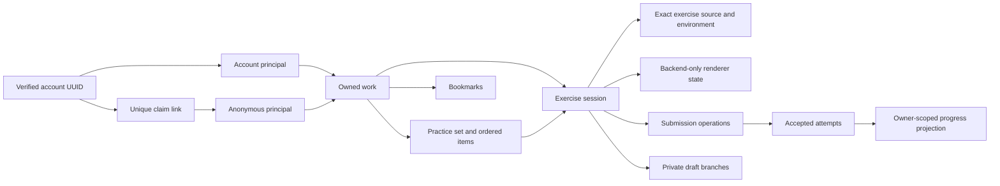

# Student records, ownership and privacy boundaries (task 5.6)

Defined 2026-11-16 after compatibility model `a4fdeaa`. Builds on [identity/source versions](EXERCISE_IDENTITY.md), [taxonomy](TOPIC_TAXONOMY.md), [metadata](CATALOG_METADATA.md), and [compatibility/activation](COMPATIBILITY_DATA_MODEL.md). This task specifies relationships and access contracts and supplies synthetic reference checks. It does not integrate Supabase accounts, change live authentication, claim guest work, apply RLS/SQL or migrate real student records.

## Decisions

1. Every student record belongs to a stable **student principal**. An account principal links to a verified Supabase auth.users UUID; an anonymous principal is controlled by a verified high-entropy browser credential. User-supplied owner IDs, usernames, email addresses and profile roles are not ownership proof.
2. An explicit, unique **anonymous-to-account claim link** gives the authenticated account access to that principal's existing records without copying or renumbering them. Once claimed, the old guest credential alone loses authority. Claims never silently move between accounts.
3. Public catalog metadata, owner-visible work, backend-only renderer state and operator verification evidence have separate access surfaces. Owning a session does not grant direct database/browser access to its seed, renderer tokens or instructor data.
4. Preserve the exact exercise/source/environment, generated answer names, ordered repeated-name pairs, seed and renderer state throughout a started session. Accepted attempts are separate from unfinished drafts and submission-operation state.
5. Grading and accepted results are backend-authoritative. Preserve legacy client grades and unbound renderer snapshots as explicitly different provenance; do not manufacture pinned historical PG attempts or account ownership.
6. Suppressed feedback cannot leak indirectly through correctness counters, topic completion, mastery, badges, history summaries or search. Attempt submission can be recorded neutrally without disclosing a hidden grade.
7. First account integration uses owner-scoped backend mutations/projections, with restrictive database grants/RLS as defense in depth. SQL policies, transaction/index implementation and deployment credentials remain later tasks; reference booleans are not authentication middleware.

## Current implementation versus the target model

The current experimental service hashes a random browser owner credential, compares it before reading/restoring/grading, masks missing/unowned sessions as the same 404, and atomically replaces tokens plus latest submission. The HTTP projection omits private seeds/tokens, projects safe PG feedback and redacts suppressed scores. Its grading guard covers one Node process, not a distributed deployment.

Current drafts are session-bound sessionStorage records with checked-baseline and pending-submission reconciliation, not account/server drafts. Current private JSON keeps only lastSubmission plus submissionCount; old token-only files are valid. Neither historical source-version UUIDs nor full attempt history can be inferred from those records.

The original Supabase app has account profiles and browser-inserted correctness records. Its checked-in SQL is a separate model; deployed migration/grant/policy state was not inspected. No private session volume, hosted database, account token or credential was read for this task. Code references are recorded only as checked-in source-file hashes in the observations.

## Proposed entities and relationships

Names describe a logical model for tasks 5.7/5.8; they are not deployed tables.

| Entity | Key fields and ownership | Relationships / invariants |
| --- | --- | --- |
| Student principal | UUID, immutable kind anonymous/account, active/disabled/deleted state; account principal has unique auth.users linkage | Existing auth UUIDs are reused as account references, not guessed from profiles. No nullable student owner for newly exposed HTTP records. Legacy unowned operator records stay outside student access. |
| Anonymous credential | Principal ID, server-only credential hash/version, issuance/expiry/revocation metadata | Store no raw credential in tables, responses or logs. Existing HttpOnly/SameSite credential semantics remain until account integration implements rotation/revocation deliberately. |
| Account claim | Unique anonymous-principal ID, authenticated account UUID, state, consent/proof event references, time | One account per claimed guest principal, many claimed guest principals per account. Stable owner-principal references are retained; no bulk copying sessions/attempts to fake new ownership. Revocation/deletion never re-enables the old cookie. |
| Practice set | UUID, owner principal, taxonomy release/context, creation/selection snapshot, lifecycle/current item | A private bounded sequence, not a live query whose order changes during practice. “4 of 20” counts items, never submissions or all library entries. |
| Practice-set item | Set ID, stable ordered position, exercise UUID, selected source-version/environment/activation reference, lifecycle, optional session ID | Pin the selected version/environment at set creation. A session/seed is generated only on explicit start. If unavailable later, show blocked; do not silently replace. Attached session owner and pinned identity must match the set item. |
| Exercise session | UUID, owner principal, exercise UUID, source-version/environment IDs, creation/lifecycle, generation/latest accepted reference | New sessions require exact source/environment bindings. Legacy source provenance can be legacy-unbound. Original identity/seed persists across retries/navigation; a fresh variation is a new explicit session with optional parent relation. |
| Renderer session state | Session FK, private seed, renderer tokens, state generation, private feedback policy/raw-score state needed for recovery | Backend-only relation. Advance atomically with accepted attempt state. No browser SELECT access even for the owner; renderer sees minimum per-request exercise state, not account credentials/profile details. |
| Submission operation | UUID, session/owner FK, idempotency key, canonical ordered-pair digest, base generation/publication generation, queued/in-flight/accepted/failed-before-renderer/uncertain/blocked state | Same key and same payload return the stored outcome when known. Different payload with same key conflicts. Uncertain upstream execution requires reconciliation; it cannot be retried blindly. Distributed leases/CAS/transaction implementation belongs to 5.7/5.8. |
| Accepted attempt | UUID, session FK, immutable ordinal/time, source/environment binding, exact submitted pairs, PG-authoritative score and canonical field/overall feedback, visibility/provenance | Owner must match parent; source and environment must match session. Append history and update latest accepted pointer atomically. A service/storage/transport failure is not an incorrect mathematical attempt. |
| Server draft branch/revision | UUID, session/owner FK, device/tab branch key, revision, checked-baseline ID, pending-operation reference, exact pairs and field-contract identity | Separate from graded attempts. Optimistic revision and checked-baseline checks prevent silent stale overwrites. Branch/device labels are not authentication proof. |
| Bookmark | UUID, owner principal, stable exercise UUID, optional chosen topic context/time | Does not grant access or pin a fresh seed. Preserve on withdrawal with a coarse unavailable state. Account views deduplicate the same exercise across owned/claimed principals. |
| Continue-practicing state | Owner-scoped set/item/session reference and last interaction metadata | Never a shared global pointer. Reference ownership/source availability must be checked before display/resume. Previous navigation restores the item's existing session/draft, not a new seed. |
| Progress read model | Owner-scoped derived facts, attempt/source/visibility provenance, taxonomy/release/denominator policy | Not student-writable scores or a universal mastery flag. Account views union owned/claimed principals and deduplicate attempts/versions explicitly; claimed records are not counted twice. |



A denormalized owner/source FK on a child is useful only with enforced parent consistency. Never authorize a draft/attempt by its own owner field while ignoring the session/set it points at. Future constraints must reject forged cross-owner, cross-session or cross-version references even if the client knows every UUID.

## Ownership and access matrix

The columns describe target **backend-mediated behavior** after identity verification. Base database tables are not automatically readable/writeable by the browser. Catalog editing and student-data administration are separate privileges.

| Resource/action | No owner proof | Verified guest owner | Authenticated owning account, including claimed principals | Other student / catalog editor | Trusted backend service |
| --- | --- | --- | --- | --- | --- |
| Published safe catalog/taxonomy/metadata | Read approved public projection | Same | Same | Same; editorial writes require separate grant | Publish only through defined catalog authority |
| Own profile display/preferences | No | No account profile | Read/update allowlisted own preferences; no role mutation | No private profile access by default | Scoped account operations |
| Practice set/item, bookmark, continuation | No | Owned records through API | Owned union through API | Deny; catalog role is insufficient | Owner-check and validate relationships before mutations |
| Session question/restoration/grade action | Deny, same missing/unowned public response | Owner + current eligibility | Owner + current eligibility | Deny | Enforce owner, source, generation and current gate before renderer calls |
| Draft contents/revisions | Deny | Owner through API, field-contract validation | Owner through API, revision/baseline validation | Deny | Scoped draft save/reconciliation, never a grade |
| Stored attempt answers and safe feedback | Deny | Owned history projection | Owned history projection | Deny | Persist accepted PG state; apply visibility/redaction on reads |
| Seed, tokens, credential hashes, private score state, instructor claims | Deny | Deny direct access | Deny direct access | Deny | Least-privileged backend-only access; minimum renderer request state |
| PG result/attempt insertion or score mutation | Deny | Submit answer pairs only; cannot choose result | Same | Deny | PG-authoritative accepted write only; immutable result history |
| Progress | No private history | Owned derived view | Owned union/deduplicated view | Deny | Compute suppression-aware metrics; no client-supplied correctness |
| Catalog QA/verification workers | No student data | Not applicable | Not a student permission | Catalog/evidence scope only | Separate operator sessions; no production student-cookie/token sharing |
| Support/debug/retention/export | Deny | Owner-requested flow only | Owner-requested flow only | No blanket access from admin label | Explicit purpose-bound audited tooling, not generic catalog privileges |

All browser-supplied identity, role, owner, seed, source path, source version, renderer token, score, correctness and attempt-ordinal fields are untrusted. The backend resolves identity from verified Supabase authentication and/or the existing credential proof. Service-role database access may bypass RLS, so it does not replace explicit owner authorization. Renderer and catalog workers are not authenticated students and must not use a broad service key as permission to read arbitrary work.

For initial account integration, revoke direct browser-role access to private renderer/credential/operation/evidence tables and route student writes through the backend. RLS protects readable owner-scoped relations/views where explicitly granted. RLS selects rows, not a safe subset of columns: placing tokens beside publicly selectable session columns is insufficient. Any later direct bookmark/draft RPC or invoker view must enforce the same parent consistency, allowlisted fields and ownership; it is not implicitly granted by this design.

## Explicit guest-to-account claim protocol

1. Keep guest work separate until the student chooses to save it to the signed-in account. Validate the actual account with Supabase server-side, current anonymous credential possession, request origin/CSRF protection and an explicit short-lived claim intent. Do not use an email/username match, guessed record ID or profile role as proof.
2. The claim covers the anonymous principal's existing work, not a caller-supplied bag of session IDs. Resolve that principal from credential proof. Review privacy/UX wording so another person signing into a shared browser does not silently acquire previously claimed work.
3. Block a new claim while a grading operation is in flight or uncertain. Reconcile first; never create another check as a claim side effect. Serialize claim, credential revocation, submission state and ownership generation in the eventual implementation.
4. Atomically insert the unique principal/account link, record consent/proof event references, and retire anonymous-only authority. Sessions, drafts, attempts, sets and bookmarks keep original IDs and parent links. Repeated completion by the same authenticated account is idempotent; another account cannot steal/reassign the link, even with the old cookie.
5. The account can subsequently access its native principal plus active claimed principals on another device. Merge views by stable record identity; do not duplicate attempts or progress. A shared bookmark can be displayed once without destroying original provenance. Account-level unbookmark must apply only to that account's owned union.
6. On logout/account change, clear or isolate owner-specific cached UI/drafts and query caches; the retired guest cookie must not expose claimed work. New guest work gets a new principal/credential. Authentication loss produces a recovery state, not silent conversion of claimed sessions back to guests.

Current credential Path is `/api/sessions`; a future claim handler must deliberately receive that proof under an appropriate route or implement reviewed cookie scoping. No claim endpoint exists today. Rotating/changing cookie semantics and account proof are implementation tasks, not accomplished by the reference policy. Losing an unclaimed cookie does not permit recovery by guessing IDs. Legacy unowned CLI sessions cannot be claimed as guest work by inference.

Duplicate/ambiguous claim links, revoked links and disabled/deleted principals fail closed. Deleting an account or revoking a link never reactivates the former anonymous credential. Account recovery or an exceptional correction needs a separate authorized audited flow, not an ordinary student reassignment endpoint.

## Drafts, tabs and navigation

Keep exact ordered name/value pairs, whitespace and repeated-name groups from the verified field contract. No object-key conversion that discards choices. Owner-confirmed session restoration precedes draft loading. Every draft is tied to its session/exercise, source/field contract, branch/revision and latest checked baseline; UI storage keys also need an owner/auth-context scope during future account integration.

A server draft write compares the expected branch revision and checked baseline. Revision mismatch or a newer unrelated checked result is a conflict; preserve the losing work for explicit comparison/selection instead of overwriting. A pending operation can be reconciled only using backend-known operation/submission identity and submitted pairs. Clients cannot assert “pending acknowledged” to bypass the baseline check. No automatic mathematical merge of fields or choices is implied.

The synthetic CAS check models reading revision 3, committing 4, then rejecting a second writer still expecting 3. A real database must implement that compare-and-swap atomically; the pure reference function is not a lock. The existing live tab policy remains unchanged: independent sessionStorage drafts, newer checked-result precedence with a warning, no live sync/merge or old-conflict recovery UI.

Previous/Next/Skip within a stored practice set restore the corresponding session and preserve drafts. Skip is not incorrect and does not count as completion. A withdrawn pinned item becomes blocked; choosing a replacement is an explicit action and cannot mutate history. A fresh variation starts a labeled new session/item with a new seed, retaining the old session. In the practice screen, browsing topics alone never discards or grades current work.

## Grading, operation idempotency and withdrawal

Only the backend starts a session with server-owned source/settings/seed, verifies ownership and field contract before PG, and persists the new renderer tokens plus accepted attempt atomically. The client submits ordered answers and a scoped operation key/base revision, not a score, token, source path or arbitrary attempt ID.

Persist a per-session operation key and canonical ordered-pair digest. If a request repeats after the backend accepted/saved it, return the recorded outcome without creating another attempt or advancing PG again. A reused key with a different payload is a conflict. An upstream timeout or crash may leave execution uncertain; the database cannot make an external PG request exactly-once by itself. Reconcile saved renderer state/token under the existing explicit recovery semantics and do not automatically resend an uncertain grade. Distributed locks, fencing/leases and DB transaction details follow in 5.7/5.8.

The activation/publication generation from 5.5 must be checked around dynamic grading. If withdrawal/account claim races an already produced result, preserve accepted/uncertain private state and token continuity instead of pretending the renderer was not called. Block new work according to current permissions, return a useful unavailable/recovery state and avoid duplicate submission. The current local JSON gate/one-process lock does not already implement these database protocols.

Attempt answers and feedback are owner-private and can be restored. Correct-answer maps, raw response claims and unrestricted feedback HTML are not returned. Reuse the existing safe PG message/notation projection, invalid-versus-incorrect model and suppression contract; these synthetic helpers do not replace their renderer validation.

## Progress and history privacy

Record provenance explicitly: new accepted server-PG attempts with exact source/environment; legacy renderer snapshots with unknown historical pins; legacy client-calculated correctness; and ungraded/uncertain operations. Keep original facts without promoting the latter groups to pinned PG evidence. A stored submission counter is not reconstructed attempt history, and a “saved” label is not a mathematically correct result.

The reference summary exposes stored accepted-record counts, pinned-renderer attempt counts, visible graded counts, separate withheld/unknown-visibility counts, fully-correct source-version counts and separate legacy/unbound counts. It is an illustrative privacy check, not a topic-mastery implementation. Only accepted, owned, matching pinned server-PG records with visible valid scores can contribute to that visible correctness metric. Retakes on the same exercise/version do not multiply its credit; cross-topic assignments do not duplicate attempts. Foreign or inconsistent parent/source references are excluded.

For suppressed feedback, return neutral submitted/withheld state, null scores and no correctness-bearing field messages/statuses. A hidden private score of 0 versus 1 must produce the same public feedback and progress-correctness projection. Uncertain operations and unknown visibility remain explicitly unconfirmed/unknown, not falsely labeled as authored suppression; their scores cannot create visible correctness credit either. Do not show “completed”, accuracy, streak rewards, mastery or topic badges derived from hidden scores. A prior independently visible result remains history, not permission to reveal a later withheld result.

Later topic progress needs explicit taxonomy release, eligible distinct-identity denominator and source-version credit policy. Keep historical practice visible; do not silently treat success on an old version as verified success on a changed problem. “Exercise 4 of 20” remains set position, and skipped/blocked items remain distinct. Account aliases/claims must not double-count the same accepted attempt.

## Supabase migration and privacy constraints

Checked-in policies protect own profile rows but do not themselves restrict the later-added role column; role-based catalog writes depend on that role. Existing own-attempt insert/update policies accept client correctness and the active browser component inserts it directly. Exercise SELECT permits public rows containing authored solution fields. These are source-audit findings, not deployed database penetration tests: actual grants/triggers/applied state were not queried.

Before account integration, protect role assignment server-side/with restricted grants, keep legacy client history labeled, and create separate backend-only PG state plus safe owner projections. Do not reuse the public authored-exercise row for secrets or the client-writable attempts interface for authoritative PG results. No destructive schema.sql reset or cascade cleanup is part of this task.

All student-derived answers/drafts/history remain private even when source exercises are public OPL. Do not place them in catalog search, public verification artifacts, routine logs, screenshots, analytics payloads or shared caches. Production diagnostics use bounded coarse codes and protected operation references, with a defined access/retention purpose; hashing an identifier is not permission to publish it. Use no-store for private responses and clear owner-scoped caches on auth changes.

Account export/deletion and guest expiry require explicit product retention policies before public deployment. Normal evidence/history immutability prevents accidental catalog deletions, not an excuse to ignore an authorized privacy-erasure flow. Disable owner/claim access first and handle private state, backups, exports and audit retention deliberately; do not orphan live credentials or reclassify deleted accounts as anonymous users. No retention duration or legal compliance claim is invented here.

## Executable reference checks

[student-record-examples.json](catalog-model/student-record-examples.json) contains symbolic principal/session/set references only, no real UUID allocation or personal/session values. [student-record-policy.mjs](catalog-model/student-record-policy.mjs) evaluates reference ownership, claim planning, draft CAS/baseline checks, owner-only attempt projections and suppression-aware summary rules. Its actor facts are assumed verified by a future backend: a client-provided verifiedAnonymousPrincipalKeys array is never authentication proof. Do not import this helper as production authorization/RLS or accept its actor shape directly from an HTTP body.

From the repository root, with the existing workspace running:

```powershell
powershell.exe -NoProfile -ExecutionPolicy Bypass -File ./experimental-workspace/catalog-model/verify-student-record-model.ps1
```

The [runner/checks](catalog-model/verify-student-record-model.ps1) execute in a separate Node process using only synthetic data and checked-in code-reference hashes. They neither read `/data/sessions`, call Supabase/PG, alter accounts/claims, restart services nor write SQL. Only [sanitized observations](catalog-model/student-record-observations.json) are copied from temporary storage; disposable answer/private-marker strings stay inside test code/memory, not the committed observations.

Fresh result: **22 checks pass** for relationship consistency, own/foreign/guest access, role non-bypass, unowned legacy records, forged child references, explicit/replayed/blocked claims, claim-cookie retirement, ambiguous/revoked principals, stale draft revisions/baselines, ordered answers, private-field exclusion, uncertain grades, suppression/progress leakage, legacy provenance, foreign/version exclusion, retake deduplication and no fixture mutation.

These are model/reference checks, not deployed RLS, live account transfer, transaction race testing, browser account-switch acceptance or new renderer compatibility evidence. Existing app and 42/44 compatibility results remain historical. Task 5.7 is now specified in [DATABASE_DESIGN.md](DATABASE_DESIGN.md), with a guarded PostgreSQL lab validating critical ownership, parent consistency, uniqueness, atomicity and privacy requirements. **5.8** implements additive migrations and database validation; the lab is not a deployed migration.
