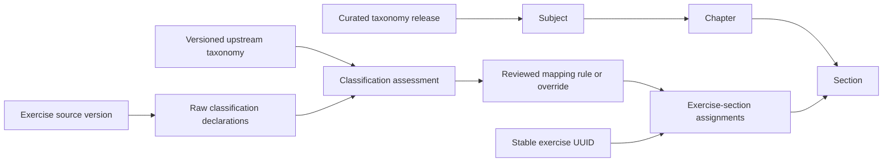

# Raw classifications and curated topic hierarchy (task 5.3)

Design decision, 2026-11-15, following identity design `68fb4fb`. Builds on [CATALOG_MODEL_AUDIT.md](CATALOG_MODEL_AUDIT.md) and [EXERCISE_IDENTITY.md](EXERCISE_IDENTITY.md). This defines the model and browsing contract; database migrations, bulk importing, student UI integration and new activation are not part of this change.

## Decisions

1. Preserve source classifications as immutable evidence attached to an exact exercise source version. They are not student-facing topic IDs and are never overwritten by friendly labels.
2. Curated navigation is a strict three-level tree: **Subject → Chapter → Section**. A topic node has one parent in a particular taxonomy release; an exercise can belong to several sections, including sections in different subjects.
3. Curated nodes use opaque persisted UUIDs allocated later. Labels, slugs, order, source strings and fixture keys are not identities. Existing authored-course units/themes/subthemes remain intact and require explicit mappings rather than automatic renaming.
4. Version the source vocabulary, curated releases, mapping rules and exercise assignments. Indexing/classification never grants renderer compatibility, publication, account ownership or practice availability.
5. Missing, partial, repeated/conflicting, malformed and unmatched metadata remain visible in operator diagnostics. They do not block metadata ingestion and must not become guessed taxonomy labels. An eligible but unclassified exercise can still be found through search or an uncategorized collection.
6. Scale using reviewed mapping rules and complete taxonomy releases, not a requirement to manually classify every file. Exact matching can propose mappings in bulk; explicitly approved rules can publish assignments in a reviewed release. Ambiguous cases stay unresolved instead of being forced into an arbitrary branch.

## Proposed model and relationships

These are logical entities for tasks 5.6–5.8, not new SQL tables deployed by this task.

| Entity | Minimum information | Relationship / constraint |
| --- | --- | --- |
| Source taxonomy version | Repository/snapshot identity, file path, file hash, parser version, parse diagnostics | Retain both upstream Taxonomy files independently. A label correction in our UI does not edit a source taxonomy version. |
| Source taxonomy node | Vocabulary version, level, raw label, parent, source location | Source Subject/Chapter/Section identity is contextual. Identical section labels under different parents are not equivalent. |
| Raw classification declaration | Exercise source-version ID, field, occurrence order, line, raw text/argument, parsed value, parser version | Keep every DBsubject/DBchapter/DBsection occurrence, including blanks and malformed declarations. No destructive normalization or zipping unrelated repeated fields. |
| Classification assessment | Source-version ID, declaration set, chosen vocabulary version, status, matched source triple if any, diagnostics | Assessment is reproducible and tied to the parser/vocabulary; new parsing creates another assessment rather than erasing raw evidence. |
| Curated topic node | Stable UUID, immutable kind: subject/chapter/section, creation provenance | One semantic node survives a friendly-label change. Kind changes need a new node and explicit relation. No path-derived UUIDs. |
| Curated taxonomy release | Release UUID/version, draft/published/retired state, source vocabulary references, review provenance | A published release is immutable. Prepare corrections in a new release and publish atomically; preserve old releases for routes/history. |
| Node membership/presentation | Release ID, node ID, parent node ID, locale, label, slug, sibling position, visibility | Subject parent is null; chapter parent is a subject; section parent is a chapter in the same release. No cycles, orphans or fourth level. Unique sibling slug and position per release/locale; labels need not be globally unique. |
| Mapping rule/version | Release, full raw triple or explicit source/alias scope, target section IDs, primary-choice policy, provenance, approval | A rule can cross-list into multiple sections. Store original inputs and the exact reviewed transformation; no untracked fuzzy correction. |
| Exercise-section assignment | Stable exercise ID, release/section ID, source-version applicability, rule/override provenance, state, primary flag | Many-to-many, unique exercise/section within a release and active source-version applicability. Exactly one primary among approved assignments when at least one exists; zero assignments is valid. |
| Mapping proposal/diagnostic | Source-version/assessment, candidate rules/targets, reason, review outcome | Missing/ambiguous mappings are recoverable work items, not dropped exercise rows or fabricated sections. |
| Topic route alias / legacy mapping | Namespace, locale/context, old route or legacy topic ID, target node/release or explicit tombstone | Keep bookmarks/URLs traceable. Old topic strings do not determine parentage or globally identify a node. No silent alias recycling. |



The identity relationship is unchanged: topics classify an exercise; they do not own its ID, source or accepted results. A cross-listed exercise remains one exercise, not a cloned exercise/session/progress record.

## Source vocabularies and classification states

Use the pinned **OpenProblemLibrary/Taxonomy** as the initial exact-match vocabulary for import proposals, with its source revision and SHA-256 recorded. Preserve **Taxonomy2** as alternative source evidence, not an automatically preferred replacement. The audit found 30 subjects / 1,347 distinct section triples in Taxonomy and 31 / 1,506 in Taxonomy2; the latter retains a literal `Precalculus <<<` label. Publication must use reviewed mappings rather than exposing source labels blindly.

This initial choice defines matching provenance, not an assertion that every unmatched source classification is wrong. Retain unmatched tuples and potential alternative matches. The full-library importer should stage the complete baseline vocabulary, then apply reviewed label/grouping rules; the six-subject examples in this task are not a restriction on eventual subject coverage. Source areas OpenProblemLibrary/Contrib/Pending remain separate provenance scopes, never subjects inferred from directory names.

| Assessment | Meaning | Import / mapping behavior |
| --- | --- | --- |
| matched | Exactly one usable declaration per level and full tuple matches the selected vocabulary | May produce an exact mapping proposal; only an approved rule/release creates a published curated assignment. |
| missing | No usable classification values | Import exercise with no derived assignment; retain declarations/diagnostics. Do not guess subject from its institution/directory. |
| partial | Some usable levels, others absent/blank/placeholders | Preserve partial facts. Do not attach directly to a parent or invent a generic section to satisfy a foreign key. |
| conflicting | Repeated level declarations, including repeated identical values until reviewed | Preserve all occurrences; no first/last-value wins and no Cartesian product or positional zipping. |
| malformed | Classification-like declaration cannot be safely parsed | Preserve raw line and parser diagnostic; no executable Perl evaluation to obtain a label. |
| unmapped | Complete usable tuple does not exactly match the selected vocabulary | Retain as a source fact, show alternatives/alias proposals; it is not automatically invalid or unsupported PG. |

Raw bytes and raw declaration spelling are retained. The matching parser may trim surrounding whitespace and one paired outer quote layer, recording that transformation. Tag names may be recognized case-insensitively; **values remain case-sensitive**. Case-folding, punctuation removal, Unicode normalization, spelling corrections, broad synonyms and “close enough” labels can generate proposals only. Persist explicit reviewed aliases before using them for assignments. Never infer an entire tuple from a shared section label.

The small lexical checker in this task demonstrates these states for line-local declarations; it is not a complete metadata parser for every PG source convention. The production importer must retain unknown syntax and explicit parser provenance, including multiline/comment variants.

## Mapping and override policy

1. Resolve an explicit reviewed exercise/source-version override if present; it may intentionally supply several sections even when source metadata is absent.
2. Otherwise evaluate approved rules against the exact full source tuple and vocabulary/scope. A subject rename/grouping such as Calculus - single variable → Calculus must be recorded as a rule, not a mutation of the source record.
3. An explicitly reviewed source alias may qualify an otherwise unmatched tuple. Keep original text and the alias version in assignment provenance.
4. Competing incompatible targets or multiple primary choices stay a conflict. Do not choose by database order, shortest label, alphabetical order or match confidence. A deliberate cross-list is represented explicitly rather than treated as a conflict.
5. Without a valid reviewed rule/override, leave the exercise unassigned and indexed. Metadata incompleteness does not itself change renderer eligibility.

Assignments apply to an exact source version by default. On a new source version, retain prior assignments as history and recompute proposals against that version. An approved rule may be reapplied in bulk when its inputs/scope still match, without per-file manual review; record the new rule/input/version relationship. An old manual assignment is not automatically proof that a substantially changed source still teaches the same topic. Editorial overrides, exclusions and provenance must survive a reimport rather than be overwritten by upstream strings.

The primary section supplies a fallback breadcrumb only when a student has no valid selected topic context. Browsing through a secondary assignment should preserve that branch in breadcrumbs, Back/Forward and practice-set context. Primary does not mean the only topic that receives legitimate progress credit; that policy is deferred to account/progress design.

## Concrete design examples

[taxonomy-examples.json](catalog-model/taxonomy-examples.json) contains **30 nodes across six subjects**, mappings for all eleven existing catalog entries and one additional source-only differential-equations example. All internal node UUIDs are null; fixture keys are references for review, not production IDs or migration output. Assignments are curated design examples, not published classification approvals.

| Exercise/example | Original OPL classification | Proposed student-facing section(s) |
| --- | --- | --- |
| Dot products and vector operations | Geometry → Vector geometry → Dot product, length, and unit vectors | Linear Algebra → Vectors → Dot products (primary); Geometry → Vector geometry → Dot products (secondary) |
| Evaluate a derivative at a point | Calculus - single variable → Differentiation → Derivatives involving multiple rules (all rules) | Calculus → Differentiation → Evaluating derivatives |
| Differentiate a quotient | Calculus - single variable → Differentiation → Quotient rule (without trigonometric functions) | Calculus → Differentiation → Quotient rule |
| Add scaled matrices | Linear algebra → Matrices → Matrix algebra | Linear Algebra → Matrices → Matrix arithmetic |
| Hypothesis-test decisions | Statistics → Hypothesis tests → Type I/type II errors and power | Statistics → Hypothesis tests → Errors and power |
| Population growth and explanations | Algebra → Exponential and logarithmic expressions and functions → Applications and models - population growth | Algebra → Exponential functions → Population growth |
| Demand elasticity and revenue | Calculus - single variable → Applications of differentiation → Elasticity of demand | Calculus → Applications of derivatives → Demand elasticity |
| Integral and derivative in stages | Calculus - single variable → Integrals → Fundamental theorem of calculus | Calculus → Integration → Fundamental theorem of calculus |
| Combine functions from a graph | Algebra → Functions → Compositions and combinations of functions | Algebra → Functions → Combining functions |
| Read a function and derivative graph | Calculus - single variable → Applications of differentiation → Increasing/decreasing functions and local extrema | Calculus → Differentiation → Reading derivative graphs |
| Plot points on a linear equation | No DBsubject/DBchapter/DBsection declarations in the selected source | Algebra → Linear equations → Plotting linear equations, as an explicit curated design example rather than an inferred source match |
| OPL `274/Exact/prob1.pg` | Full exact tuple recorded in observations | Differential Equations → First-order equations → Exact equations; source-only example, not indexed or enabled in the app |

The GraphTool example shows that an exercise can have a proposed curated topic despite missing raw tags, while still being disabled for an entirely different compatibility reason. Conversely, topic matching cannot make GraphTool or another candidate playable. The six subjects illustrate the attached home-screen direction, not a six-subject full-library whitelist.

## UI and query contract

### Home and chooser

- Home cards come from the published release and current eligibility counts; do not expose operator file paths, metadata diagnostics, seeds or renderer settings.
- Default practice browsing shows branches with playable exercises. A separate explicitly labeled indexed-library view may show unavailable entries/counts. A draft subject or source-only example must not create a misleading active Practice card.
- The chooser uses the selected subject to load chapters and selected chapter to load sections. Clear invalid descendants when a parent changes. Section selection shows its breadcrumb and enables Practice only when an eligible practice selection exists.
- A larger library needs additional subject discovery/search and progressive loading, not a fixed six-card limit. Do not download every exercise or full classification record to fill the chooser.
- On mobile, use progressive subject/chapter/section drill-down with a clear Back action and retained selection. On desktop, preserve the three-column layout in the supplied mockup. Labels, selected state, focus movement and loading/error/empty announcements belong to each navigation step.
- Topic selection alone does not replace a live exercise, erase a draft or submit answers. Starting a different exercise still follows protected navigation. A student can browse another branch while keeping current work.

### Counts, URLs and continuation

- Count **distinct stable exercise IDs** within a selected subtree and current eligibility scope, not assignments, versions, sessions or the sum of child totals. Distinct counts apply separately to indexed/playable views.
- Cross-listing intentionally makes counts non-additive: the fixture's six playable IDs produce seven subject memberships because dot product appears under both Linear Algebra and Geometry. The root still contains six unique playable exercises. Source-only and disabled examples never count as playable.
- Empty branches in the indexed view explain zero playable entries and offer navigation/search; they do not start a hidden replacement exercise. Uncategorized is a collection/filter, not a fabricated seventh subject or an invented source assignment.
- Use stable node references plus published release/context in routes; friendly slugs are presentation and may be aliased. Preserve old paths or show a useful retired-topic state rather than rebinding a bookmarked route to a different concept.
- A breadcrumb reflects the valid chosen branch; a cross-listed exercise reached through Geometry should not jump to its primary Linear Algebra branch. Invalid old context falls back explicitly to a valid primary route or the catalog without changing the exercise session.
- “Exercise 4 of 20” belongs to a practice-set snapshot, not a topic assignment count. Topic progress must deduplicate identities and define its eligibility/version denominator in later progress work; cross-listing does not create additional accepted attempts or imply mastery.

### Release and editorial changes

Rename labels or reorder siblings in a draft release; keep topic UUIDs and historical routes. Reparenting is a new release membership with a valid level/parent and reviewed subtree/alias impact. A change of node kind or mathematical meaning requires a new identity and explicit relationship. Retired nodes/assignments remain queryable; never cascade-delete exercises or attempts when changing a tree. Concurrent release publication and cached-count invalidation must be designed with constraints/queries in task 5.7 and implemented transactionally later.

## Verification and limits

Run from the repository root with the existing workspace and renderer running:

```powershell
powershell.exe -NoProfile -ExecutionPolicy Bypass -File ./experimental-workspace/catalog-model/verify-taxonomy-examples.ps1
```

The [runner](catalog-model/verify-taxonomy-examples.ps1) validates the example tree and assignment coverage, reads live eligible IDs from the existing gate, verifies both pinned vocabulary hashes and all eleven catalog-source hashes, and extracts only classification comment lines from those sources. The supplemental differential-equations source is read from the exact pinned Git object. It writes [sanitized observations](catalog-model/taxonomy-design-observations.json), preserving original declarations/line numbers and classification results without renderer execution or student/session access.

Fresh result: **30 nodes, six subjects, eleven catalog examples, one source-only example and nine classification scenarios pass**. The checker confirms sibling slug/order uniqueness, correct parent levels, no orphan nodes, section-only assignments, one valid primary choice, complete legacy coverage and distinct-identity counting. It also demonstrates that `vectors` and `dot-products` slugs may recur under different parents. The nine scenarios cover missing/partial/empty, repeated/conflicting, case variants, unknown labels, exact quoted values, malformed syntax and wrong ancestors.

These are design/fixture checks, not a database constraint test, full-library import, browser accessibility test or compatibility recertification. No application, SQL, stored session, account, active catalog or renderer dependency changes. Existing 173-server/62-browser results remain prior implementation evidence. Manual screen-reader listening and physical-device review remain separate release checks.

Task 5.4 is now specified in [CATALOG_METADATA.md](CATALOG_METADATA.md), with executable projection/search examples and a local preview. Next: **5.5 — compatibility evidence and activation**, preserving the existing fail-closed rules.
